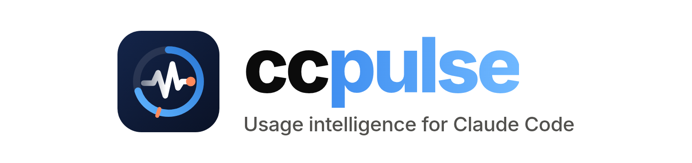
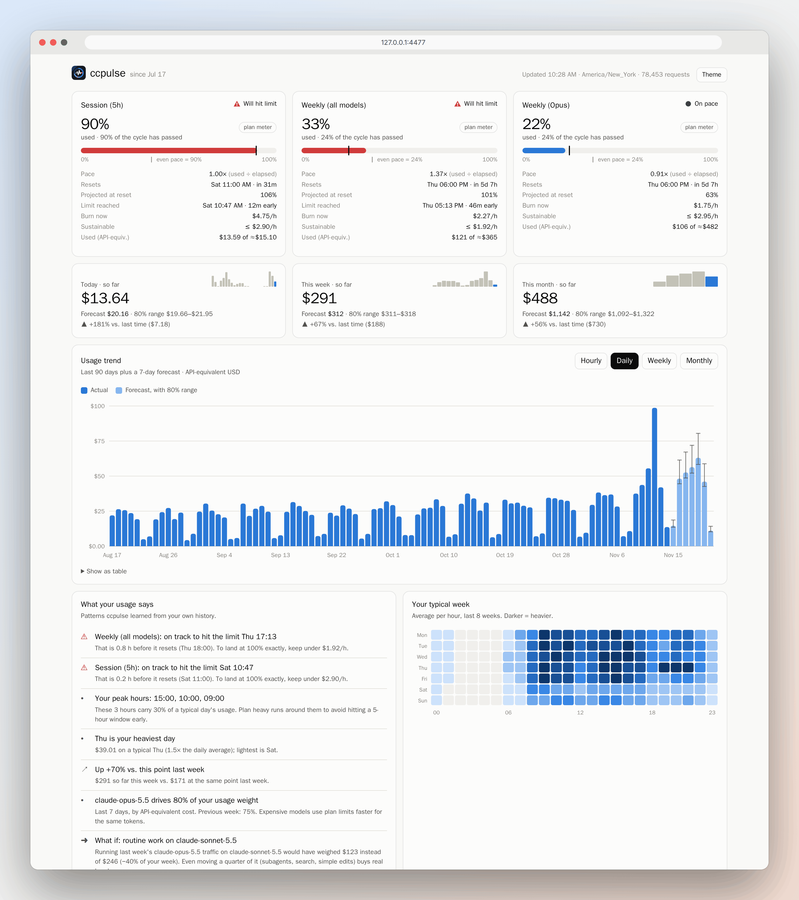
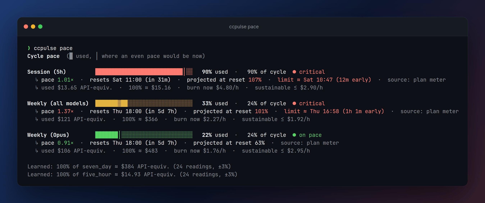
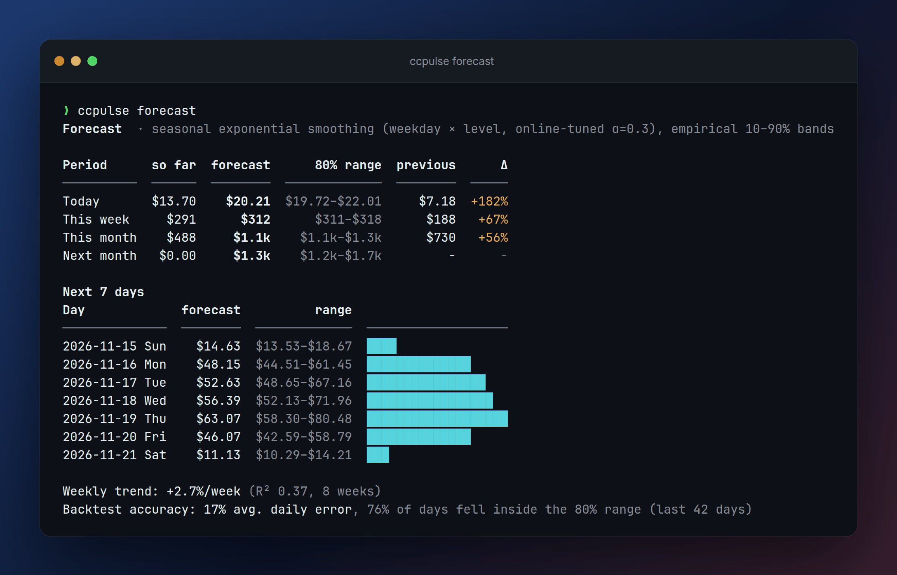
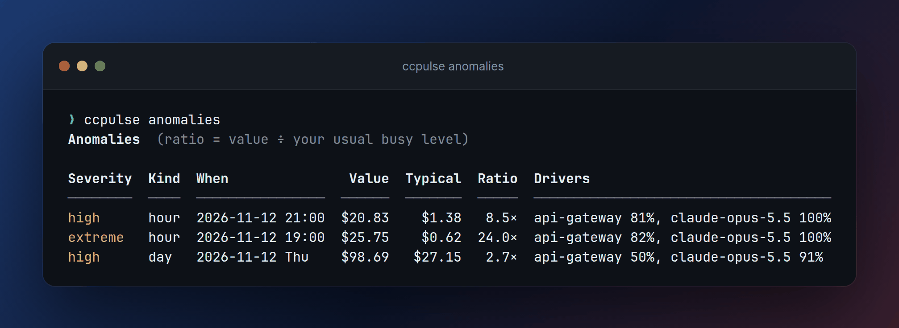
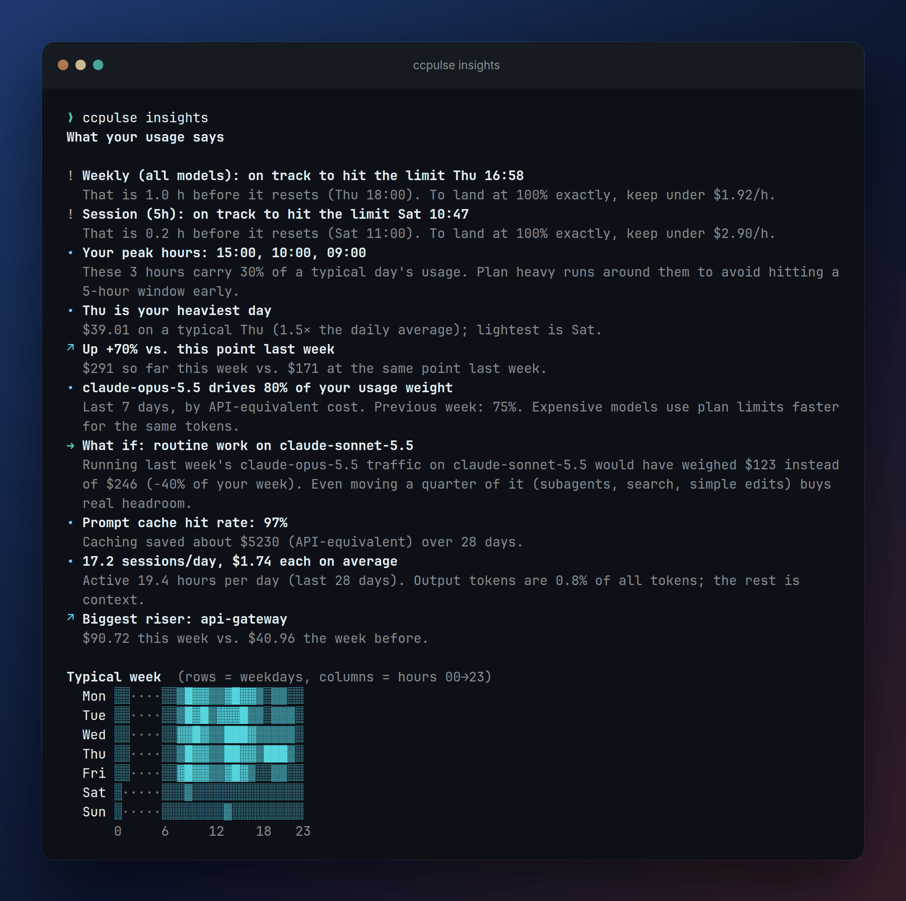
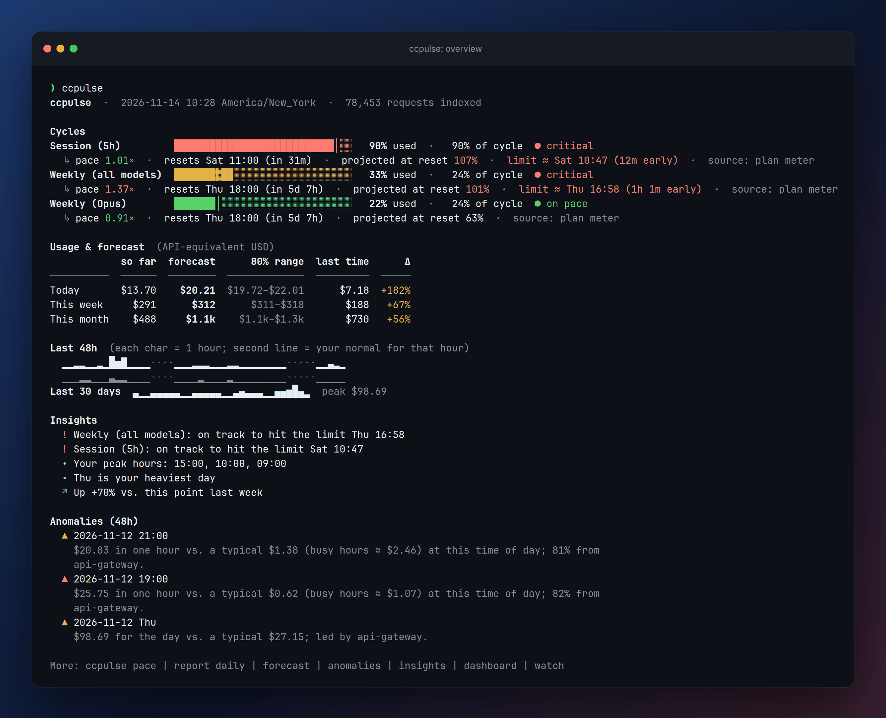
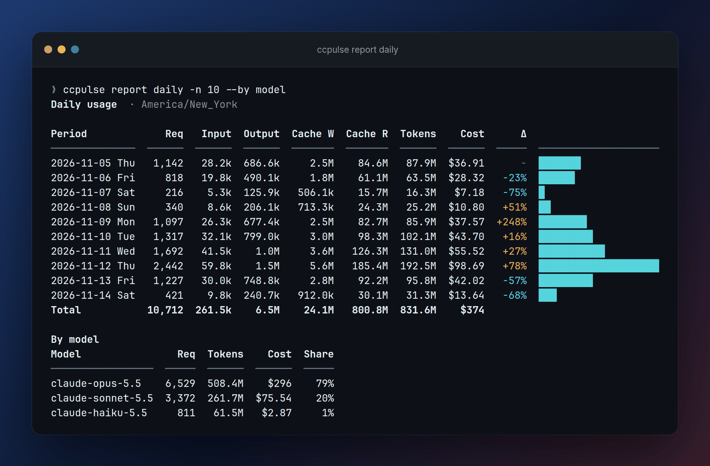
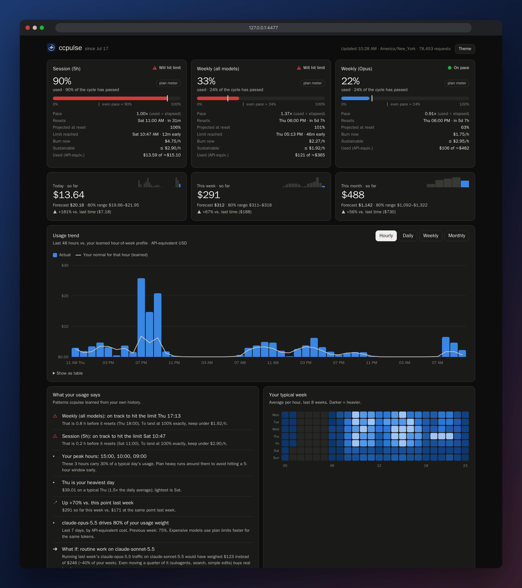
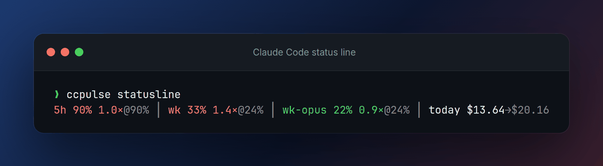

<p align="center">
  <picture>
    <source media="(prefers-color-scheme: dark)" srcset="docs/images/logo-dark.png">
    
  </picture>
</p>

<p align="center">
  <b>Understand, learn from and forecast your Claude Code usage.</b><br>
  Cycle pace · limit forecasts · anomaly detection · alerts · a local dashboard. Zero dependencies, 100% local.
</p>

<p align="center">
  <a href="https://github.com/Taflynx/ccpulse/actions/workflows/ci.yml"></a>
  
  
  <a href="LICENSE"></a>
</p>

<p align="center">
  <picture>
    <source media="(prefers-color-scheme: dark)" srcset="docs/images/dashboard-dark.png">
    
  </picture>
</p>

---

Usage limits work in cycles: a 5-hour session window and a weekly window. Knowing what you spent yesterday doesn't answer the question that matters mid-week: **am I burning faster than the cycle is moving, and when will I hit the wall?**

ccpulse answers it. It reads the logs Claude Code already writes on your machine, learns your personal rhythm, and tells you:

| | |
|---|---|
| **⏱ Where you are in the cycle** | Used % vs. elapsed % for the session and weekly windows, and your **pace** (1.33× = burning a third faster than the clock) |
| **🔮 Whether you'll make it** | Projected usage at reset, the **time you'll hit 100%**, and the hourly burn rate that lands you exactly at the line |
| **📈 What's coming** | Forecasts for today, this week, this month and next month, with 80% ranges and **honest, out-of-sample accuracy** |
| **🚨 What's unusual** | Spikes by hour, day and working session, judged against *your* history, with the project and model behind each one |
| **🧠 Your habits** | Peak hours, typical-week heatmap, model mix, cache efficiency, "what if I used Sonnet for routine work" |
| **🔔 Alerts that matter** | Desktop, ntfy, Telegram, Slack, Discord, webhooks or any command, with cooldowns so the same alert doesn't repeat |

## Quick start

```bash
npx ccpulse            # overview in your terminal
npx ccpulse dashboard  # local dashboard at http://127.0.0.1:4477
npx ccpulse --demo     # try everything on realistic synthetic data
```

Requirements: Node.js 20 or newer, and Claude Code used on this machine. Before the first npm release, run it straight from GitHub with `npx github:Taflynx/ccpulse`. The first run indexes your logs (≈40 s for 5 GB). After that, ccpulse reads only the bytes appended since the last run, so commands finish in about 2 seconds.

## A tour

### Cycle pace: the question you actually have



Each bar shows how much of the window you've used. The **│** marks where an even pace would put you right now. When usage is ahead of the marker, ccpulse projects the rest of the cycle from your learned weekly rhythm and tells you when you'd hit the limit and how much hourly burn is sustainable.

### Forecasts with receipts



Every forecast comes with its own track record. The model re-tunes itself each day using only the data before that day, and the reported error and range coverage come from that strictly out-of-sample backtest.

### Anomalies, explained



Agent usage is spiky and full of zeros, so averages and standard deviations cry wolf. ccpulse compares each hour with the same hour of day, each day with your recent days, and each working session with that project's past sessions. Every anomaly names its drivers: project, model and session.

### What your usage says



### Everything at a glance



<details>
<summary><b>More: reports, hourly dashboard view, status line</b></summary>

<br>

`ccpulse report daily --by model` (also `hourly`, `weekly` and `monthly`):



Hourly view: the last 48 hours against your learned normal for each hour of the week.



The Claude Code status line: used %, pace and cycle progress in one line.



</details>

## Commands

| Command | |
|---|---|
| `ccpulse` | Overview: cycles, forecast, last 48 h vs. normal, top insights and anomalies |
| `ccpulse pace` | Cycle detail: pace, projection, limit ETA, burn and sustainable burn, learned limits |
| `ccpulse report <hourly\|daily\|weekly\|monthly> [-n N] [--by model\|project]` | Usage tables with Δ vs. the previous period |
| `ccpulse forecast` | Today / week / month / next month, the next 7 days, trend, accuracy |
| `ccpulse anomalies [--days N]` | Unusual hours, days and working sessions |
| `ccpulse insights` | Habits, heatmap, what-ifs |
| `ccpulse dashboard [--open] [--port N]` | Local web dashboard (binds to 127.0.0.1) |
| `ccpulse watch [--interval 5m] [--once] [--dry-run]` | Evaluate the alert rules and notify |
| `ccpulse statusline` | One-line summary for Claude Code's status bar |
| `ccpulse alerts test` | Send a test alert to every configured channel |
| `ccpulse config init` | Create `~/.config/ccpulse/config.json` |

Global flags: `--json`, `--metric cost|tokens`, `--tz <zone>`, `--week-start monday|sunday`, `--offline`, `--fresh`, `--demo` and `--no-color`.

## Alerts in two minutes

```bash
ccpulse config init                  # writes ~/.config/ccpulse/config.json
export CCPULSE_NTFY_TOPIC=my-secret-topic   # or Telegram, Slack, Discord, webhook…
ccpulse alerts test
ccpulse watch                        # or run `ccpulse watch --once` from cron / systemd / launchd
```

You get alerted when:
- your **pace** crosses 1.25×;
- the projection says you'll **hit the limit before reset**;
- you cross **50 / 75 / 90%** of a window;
- an hour, day or session is **unusual for you**.

All thresholds are configurable. See [docs/alerts.md](docs/alerts.md).

## Status line

Add this to `~/.claude/settings.json`:

```json
{ "statusLine": { "type": "command", "command": "npx -y ccpulse statusline" } }
```

The line reads `5h 36% 1.1×@33% │ wk 61% 1.3×@46% │ today $133→$327`: used %, pace, and @ how far through the cycle you are. Results are cached for 60 seconds, so refreshes take about 50 ms.

## How it works

ccpulse is built from five layers. Each one is documented in depth in [docs/how-it-works.md](docs/how-it-works.md).

1. **Index.** It reads `~/.claude/projects/**/*.jsonl` incrementally and deduplicates responses with the same rules as [ccusage](https://github.com/ccusage/ccusage); its daily totals match ccusage's.
2. **Price.** Every response is priced at API-equivalent cost, including 1-hour cache writes and long-context tiers. Cost weights tokens by model, which tracks plan limits better than raw token counts.
3. **Find the 100% mark.** ccpulse looks for it in this order:
   - the plan meter behind Claude Code's `/usage`, read-only;
   - a limit **learned** from past meter readings, so it keeps working offline;
   - your config;
   - your own history, which is clearly labeled and never triggers limit alerts.
4. **Learn your rhythm.** A recency-weighted profile of your 168 hours of the week, plus a seasonal forecast whose smoothing is re-tuned online every day.
5. **Judge with quantiles.** Anomalies are scored as `(x − p50) / (p90 − p50)` against the same hour of day, your recent days, or the same project's sessions.

## Privacy

- Nothing leaves your machine except two kinds of call. The first is the plan-meter request, which goes to Anthropic with your own token; turn it off with `--offline`. The second is the alert channels you configure.
- No telemetry, no accounts, no runtime dependencies.
- The dashboard listens on loopback, blocks DNS-rebinding, and sends a strict CSP.

## FAQ

<details><summary><b>Is the cost what I pay?</b></summary>

Only if you're billed through the API. On Pro and Max plans it's an *API-equivalent* number: a consistent, model-weighted way to measure usage, the same basis ccusage uses. The percentages come from the plan meter when it's available.
</details>

<details><summary><b>Why does the plan meter show more than my logs?</b></summary>

The meter counts everything on your account, including claude.ai and other machines. Local logs only cover Claude Code here. When the gap is large, ccpulse points it out.
</details>

<details><summary><b>How accurate are the forecasts?</b></summary>

It depends on how regular you are, and ccpulse tells you. `ccpulse forecast` prints the average daily error and how often reality fell inside the 80% range over the last 42 days, measured out-of-sample. Weekly totals are far more predictable than single days.
</details>

<details><summary><b>Does it work with ccusage?</b></summary>

Yes. Use ccusage for multi-agent reports and ccpulse for the analytics and alerts. The two read the same files and don't interfere.
</details>

<details><summary><b>The plan-meter endpoint isn't public. Is that safe?</b></summary>

ccpulse calls it read-only with the login Claude Code already has. It never refreshes, copies or stores the token. If the endpoint changes, ccpulse falls back to learned or configured limits. You can turn it off entirely with `limits.useOfficial: false`.
</details>

## Documentation

- [How it works](docs/how-it-works.md): data, dedup, pricing, cycles, the learning loop, forecasting and anomaly math
- [Configuration](docs/configuration.md): every option, environment variables, files on disk
- [Alerts](docs/alerts.md): rules, channels, running in the background
- [Contributing](CONTRIBUTING.md)

## Credits

- Log parsing and deduplication follow [ccusage](https://github.com/ccusage/ccusage) by ryoppippi (MIT).
- Pricing data is from [models.dev](https://models.dev), via ccusage's snapshot.

## License

[MIT](LICENSE)
