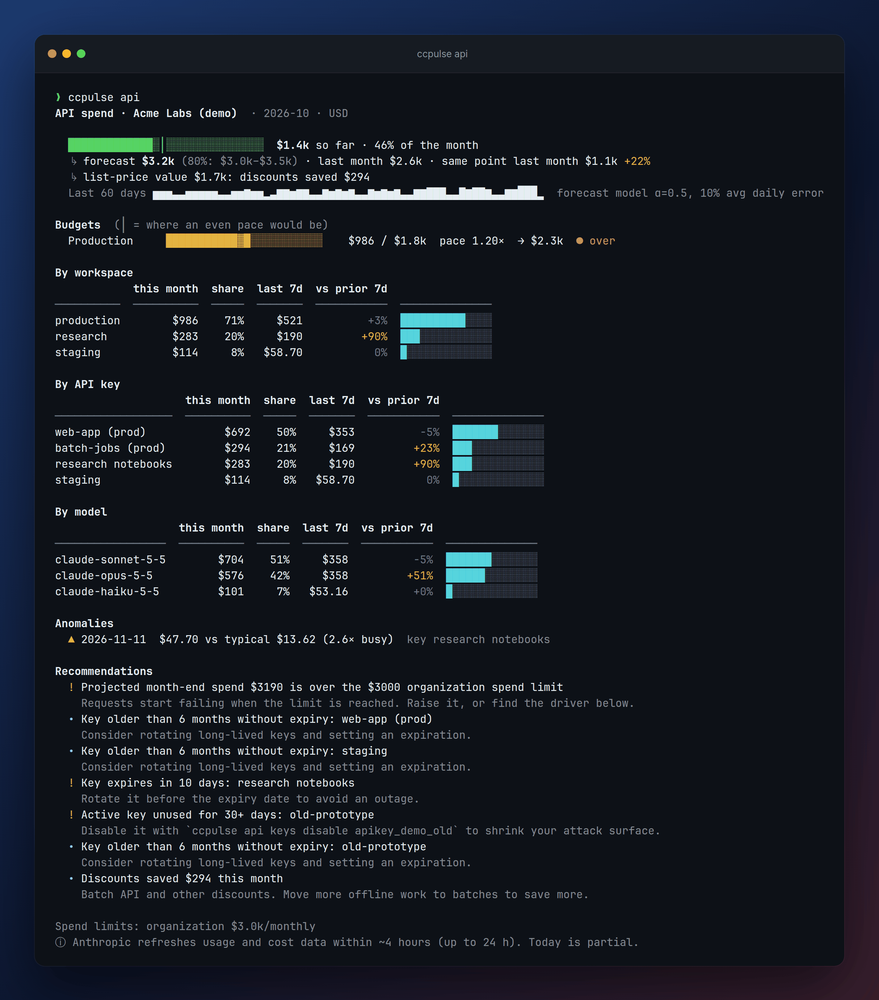
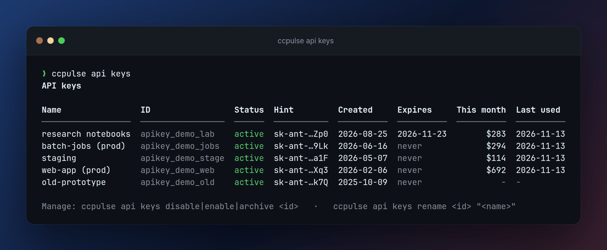

# API spend & management

Most people use Claude Code on a subscription, but many also run apps, agents or batch jobs on the Claude API. ccpulse puts both in one place. Subscription usage comes from your local logs; organization-wide API spend comes from Anthropic's Admin API.

```bash
export CCPULSE_ADMIN_KEY=sk-ant-admin01-…   # Claude Console → Settings → Admin keys
ccpulse api                                 # spend, forecast, budgets, drivers, recommendations
ccpulse api --demo                          # try it on a synthetic organization
```



## Setup

1. **Create an Admin API key.** In [Claude Console](https://platform.claude.com/settings/admin-keys), open Settings → Admin keys. You need the admin role. Admin keys start with `sk-ant-admin`; regular API keys are rejected by these endpoints.
2. **Give it to ccpulse.** Either:
   - set `CCPULSE_ADMIN_KEY` (or `ANTHROPIC_ADMIN_KEY`) in the environment, or
   - set `api.adminKeyFile` in the config to a file readable only by you (`chmod 600`).

   ccpulse never writes the key anywhere.
3. **Install the SDK if needed.** API features use the official [Anthropic TypeScript SDK](https://github.com/anthropics/anthropic-sdk-typescript). It's an optional dependency that npm installs automatically. If your install skipped optional dependencies, run `npm i -g @anthropic-ai/sdk`.

When a key is configured, the overview, the dashboard and `watch` include API spend automatically. `--offline` turns that off.

> The Admin API isn't available to individual Console accounts or to organizations on the claude.ai Team plan. Claude Enterprise organizations use an Analytics API key instead. See [Anthropic's docs](https://platform.claude.com/docs/en/manage-claude/usage-cost-analytics-api).

## Commands

| Command | |
|---|---|
| `ccpulse api` | Month to date, month-end forecast with an 80% range, budgets, spend by workspace / key / model, anomalies, recommendations |
| `ccpulse api keys` | Every API key with status, hint, created and expiry dates, spend this month, and last use |
| `ccpulse api keys disable <id>` | Deactivate a key (requests using it fail until re-enabled) |
| `ccpulse api keys enable <id>` | Re-activate a key |
| `ccpulse api keys archive <id>` | Archive a key permanently |
| `ccpulse api keys rename <id> "<name>"` | Rename a key |
| `ccpulse api workspaces` | Workspaces with spend this month |
| `ccpulse api limits` | Your organization's rate limits per model group |
| `ccpulse api spend-limits` | Spend limits (early-access Admin API feature) |
| `ccpulse api spend-limits set <org\|wrkspc_…> <usd\|none> [--period monthly]` | Set or remove a spend limit |

Every change asks for confirmation (`--yes` skips it in scripts) and refuses to run without a terminal unless `--yes` is given. Every command supports `--json`.



## What the report computes

| | How |
|---|---|
| **Month to date** | Sum of the cost analytics (`amount`: after discounts, before credits) since the 1st (UTC) |
| **Month-end forecast** | The same online-tuned daily model ccpulse uses for your own usage ([how it works §6](how-it-works.md#6-forecasting)), run on the organization's daily spend. The 80% range comes from its own backtest. Today counts as partial, because upstream data lags |
| **Same point last month** | Last month's spend at the same elapsed fraction of the month, a fair comparison mid-month |
| **Discounts** | `list_amount − amount`: what batch and other discounts saved |
| **Budgets** | Your `api.budgets`, scoped to a workspace, key or model. Pace = used ÷ elapsed share of the month; the projection uses the forecast |
| **Anomalies** | Daily spend scored against the previous 56 days (`(x − p50)/(p90 − p50)`), plus per-key bursts against each key's own last month. The driver key is named |
| **Recommendations** | A projected overrun of the org spend limit, active keys unused for 30 days, keys expiring within 14 days, keys older than 6 months without expiry, spend concentrated on one key, a low prompt-cache hit rate per model, and the value of discounts |

## Budgets

```jsonc
// ~/.config/ccpulse/config.json
"api": {
  "budgets": [
    { "name": "Production", "monthly": 1800, "workspaceId": "wrkspc_…" },
    { "name": "Research",   "monthly": 300,  "apiKeyId": "apikey_…" },
    { "name": "Opus",       "monthly": 1000, "model": "opus" }
  ]
}
```

`ccpulse watch` alerts when a budget is pacing ahead of the month (`warn`) or is projected to end the month over budget (`critical`), once per budget per state per month. Budgets are local guardrails that warn you. To actually stop spend, set a spend limit (`ccpulse api spend-limits set …` or in the Console).

## Data and privacy

- Calls go only to `api.anthropic.com`, through the official SDK, using your Admin key.
- Responses are cached under `~/.cache/ccpulse/admin-*.json` (mode 600) for `api.cacheMinutes` (default 30). Anthropic refreshes the underlying data within about 4 hours, and up to 24 hours.
- Usage and cost analytics cover at most the last 365 days, and nothing before January 1, 2026.
- The API (beta: `analytics-usage-cost-2026-08-24`) can revise numbers for about a week after the end of a month as late events are reconciled.
