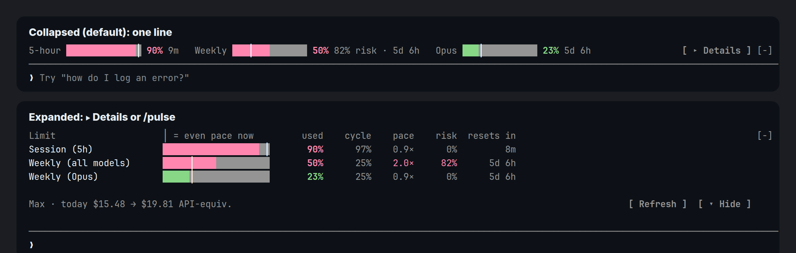

# ccpulse-bar

A live usage bar above the Claude Code prompt, in the terminal and in the desktop app.



- **Collapsed (default):** one line per plan limit, showing:
  - a solid bar in the status color, with a notch where an even pace would put you now;
  - the share of the limit you've used;
  - the risk of hitting the limit before reset (shown when it matters);
  - the time to reset.
- **Expanded** (click **▸ Details**, or run `/pulse`): an aligned table with used, cycle elapsed, pace, risk and reset, plus today's spend and forecast.
- **Colors** follow your theme:

  | Color | Meaning | When |
  |---|---|---|
  | green | on pace | |
  | orange | worth watching | risk ≥ 5%, or pace ≥ 1.25×, or ≥ 75% used |
  | red | critical | risk ≥ 50%, or ≥ 90% used |

  Risk comes from ccpulse's Monte Carlo simulation, not from a straight line.
- **Updates** every minute and after every reply.

The bar draws what the [ccpulse](https://github.com/Taflynx/ccpulse) CLI computes. On Ultra there's no 5-hour window; on Max and Ultra the Fable cap appears as its own row.

## Install

**1. Install the ccpulse CLI** (Node.js 20+):

```bash
npm i -g ccpulse
```

Until the first npm release, install it from GitHub:

```bash
npm i -g github:Taflynx/ccpulse
```

**2. Install the plugin.** At the prompt of a Claude Code terminal session:

```
/plugin install ccpulse-bar --marketplace Taflynx/ccpulse
```

Answer `y` to add the marketplace, then press Enter for the user scope. The bar appears right away, and in every session after.

From a shell instead:

```bash
claude plugin install ccpulse-bar --marketplace Taflynx/ccpulse
```

In the desktop app, where `/plugin` doesn't run:
1. Click **+** next to the prompt box, then **Plugins**.
2. Choose **Add marketplace** and enter `Taflynx/ccpulse`.
3. Choose **Add plugin**.

A plugin installed from a terminal at the user scope also loads in the desktop app's Code tab.

## macOS, Windows, Linux

The plugin finds the CLI the way each platform can run it. If it can't, the bar shows `ccpulse · <reason>` instead of failing silently.

| Platform | How it runs ccpulse |
|---|---|
| **macOS** | `ccpulse` on the PATH. If that fails, through your login shell (`zsh -lc`). Apps launched from the Dock don't inherit the shell's PATH, so Homebrew, nvm, volta or `~/.npm-global` installs are found that way |
| **Windows** | through `cmd.exe`, which resolves the `ccpulse.cmd` shim npm installs (works for nvm-windows, Volta and the default npm prefix) |
| **Linux** | `ccpulse` on the PATH, then your login shell (`$SHELL -lc`) |
| **All** | falls back to `npx --yes ccpulse` |

To point it somewhere specific, set `CCPULSE_BIN`. You can set it in the environment, or in the `env` block of your Claude Code `settings.json`:

```jsonc
{ "env": { "CCPULSE_BIN": "node /path/to/ccpulse/dist/cli.js" } }
```

For a path with spaces, use a JSON array:

```jsonc
{ "env": { "CCPULSE_BIN": "[\"node\", \"C:\\\\Program Files\\\\ccpulse\\\\dist\\\\cli.js\"]" } }
```

## Commands

| | |
|---|---|
| `/pulse` | Refresh now and expand the bar |
| **▸ Details** / **▾ Hide** | Expand or fold the bar |
| **[-]** | Collapse the band entirely (Claude Code's own control) |

## Also: the terminal status line

The plugin draws above the prompt. For a one-line text summary at the bottom of the terminal, add this to your Claude Code settings:

| Platform | Settings file |
|---|---|
| macOS / Linux | `~/.claude/settings.json` |
| Windows | `%USERPROFILE%\.claude\settings.json` |

```json
{ "statusLine": { "type": "command", "command": "ccpulse statusline" } }
```

It reads like `Ultra │ wk 61% 2.1× ⚠92% ↻4d23h │ fable 68% 2.4× ⚠94% ↻4d23h │ today $192→$409`.

## Privacy

The plugin runs the local `ccpulse` CLI and nothing else. It makes no network calls of its own. ccpulse reads your local Claude Code logs and, unless you pass `--offline`, the plan meter, which it calls with your own login.

## Development

```bash
claude --plugin-dir ./plugins/ccpulse-bar     # run a session with the plugin from this checkout
claude plugin validate ./plugins/ccpulse-bar
claude plugin test ./plugins/ccpulse-bar      # surfaces (terminal, desktop) and platforms (macOS, Windows, Linux)
```
